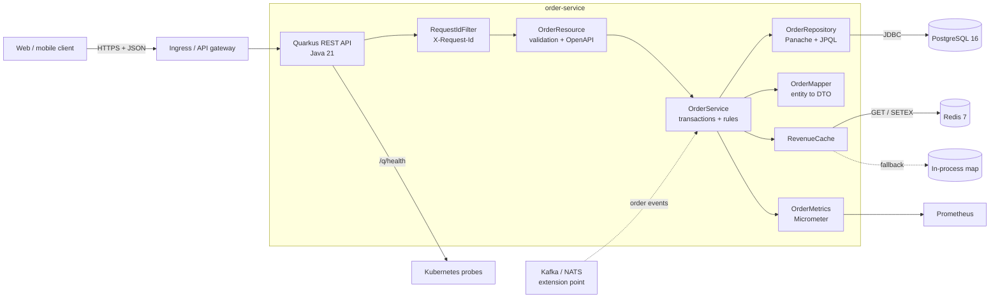
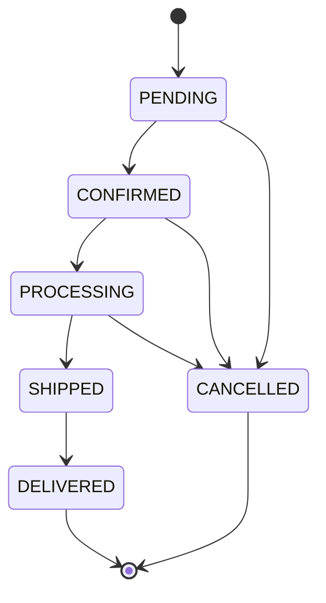
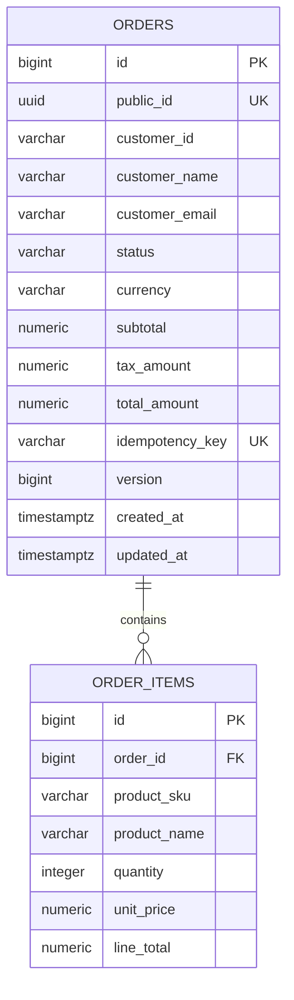

# Backend-Service-2026
<sub><span style="opacity: 0.85">Java 21 + Quarkus order service: PostgreSQL, Flyway, Redis, OpenAPI, integration tests, Docker and Kubernetes.</span></sub>
<div align="center" style="font-size: 0.9em">

</div>

[](https://github.com/devarent/backend-service-2026/actions/workflows/ci.yml)

---


<!-- identity-block -->
<div align="center">

# backend-service-2026

<sub>Java 21 + Quarkus order service: PostgreSQL, Flyway, Redis, OpenAPI, integration tests, Docker and Kubernetes.</sub>

</div>

## At a glance

| Field | Detail |
| --- | --- |
| Repository | backend-service-2026 |
| Primary language | Java |
| Topics | docker, flyway, java, kubernetes, maven, microservices, postgresql, quarkus, redis, rest-api |
| License | MIT |
| Branch | main |
| Maintainer | [@devarent](https://github.com/devarent) |

## Overview

backend-service-2026 is a hands-on repository focused on: Java 21 + Quarkus order service: PostgreSQL, Flyway, Redis, OpenAPI, integration tests, Docker and Kubernetes.. Primary language: Java. Topics: docker, flyway, java, kubernetes, maven, microservices, postgresql, quarkus, redis, rest-api. The README below documents the project; use the table above for a quick overview.

### Global references

<div align="center">

🇮🇸 Iceland &middot; 🇳🇿 New Zealand &middot; 🇨🇭 Switzerland &middot; 🇸🇮 Slovenia &middot; 🇮🇪 Ireland &middot; 🇦🇹 Austria &middot; 🇵🇹 Portugal &middot; 🇸🇬 Singapore &middot; 🇫🇮 Finland

</div>

---

<!-- dbx-style-kit -->
<div align="center">


<br>


<br>

<b>Java 21 + Quarkus order service: PostgreSQL, Flyway, Redis, OpenAPI, integration tests, Docker and Kubernetes.</b>

</div>

---
# Order Service 2026


A production-style order-management REST API built with **Java 21** and
**Quarkus 3.15**. It is deliberately small enough to review in one sitting, but
it demonstrates the parts of a real backend that matter: transactional business
rules, a documented state machine, idempotent writes, optimistic locking, Flyway
migrations, a consistent error contract, correlation ids, metrics, OpenAPI, a
Redis cache with graceful fallback, container images, Kubernetes manifests, and
a CI pipeline with a vulnerability scan.

The service is single-currency by design (USD by default) so revenue reporting
stays coherent. No credentials, generated secrets, or real customer data are
committed.

## Contents

- [What this demonstrates](#what-this-demonstrates)
- [Architecture](#architecture)
- [Order lifecycle](#order-lifecycle)
- [API](#api)
- [Quickstart](#quickstart)
- [Configuration](#configuration)
- [Testing](#testing)
- [Data model](#data-model)
- [Error handling](#error-handling)
- [Observability](#observability)
- [Security](#security)
- [Project layout](#project-layout)
- [Container and Kubernetes](#container-and-kubernetes)
- [CI and release](#ci-and-release)
- [Design decisions](#design-decisions)
- [Documentation](#documentation)
- [License](#license)

## What this demonstrates

| Capability | Where it appears |
| --- | --- |
| **Java 21 / Quarkus 3** | Records, pattern matching, constructor injection, Quarkus REST, Panache, build-time DI validation |
| **REST API design** | Versioned `/api/v1/orders` contract, pagination, filtering, OpenAPI, idempotency, `Location` headers |
| **Microservice architecture** | Stateless API, health probes, metrics, bounded resources, horizontal scaling, container image |
| **PostgreSQL and SQL** | Flyway schema, foreign keys, check constraints, indexes, JPQL `GROUP BY` revenue projection |
| **Redis / NoSQL** | Short-lived revenue cache with a bounded in-process fallback when Redis is unavailable |
| **Kafka / NATS** | Documented transactional-outbox extension point; the core workflow does not require a broker |
| **OOP and design patterns** | Aggregate root, repository, mapper, state machine, immutable DTOs, layered packages |
| **Testing** | JUnit 5, Mockito, REST Assured, H2 PostgreSQL mode; pure domain tests plus end-to-end HTTP tests |
| **Docker and Kubernetes** | Multi-stage non-root image, Compose stack, Kustomize base/overlays, probes, HPA, PDB, NetworkPolicy, ServiceMonitor |
| **CI/CD and cloud** | GitHub Actions with Temurin 21, Maven cache, Trivy scan, non-pushing image build, optional GHCR release |
| **Git and collaboration** | Conventional commits, `CONTRIBUTING.md`, `SECURITY.md`, ADR, issue-ready documentation |
| **AI-assisted development** | Small reviewable modules, deterministic tests, and an ADR make generated changes easy to verify |

## Architecture



The dashed Kafka/NATS box is intentional: no broker is required today. A
production extension would add a transactional outbox and publish
`OrderCreated` / `OrderStatusChanged` events after commit, keeping the
synchronous API independent of broker availability.

**Request flow**

1. The ingress terminates TLS and forwards the request.
2. `RequestIdFilter` accepts a safe `X-Request-Id` or generates a UUID, stores it
   in request scope, and echoes it on every response.
3. `OrderResource` deserialises and validates the payload with Jakarta Bean
   Validation.
4. `OrderService` opens a transaction, applies business rules, and delegates
   persistence to `OrderRepository`.
5. `OrderMapper` converts entities to immutable DTO records inside the
   transaction, so lazy collections are never serialised outside a session.
6. Failures are mapped to the standard `ErrorResponse` envelope with the same
   correlation id.
7. Micrometer records counters and HTTP/JVM metrics for Prometheus.

See [docs/architecture.md](docs/architecture.md) for layering rules, transaction
boundaries, failure modes, and scaling notes.

## Order lifecycle



The transition table lives in `OrderStatus` and is the single source of truth.
`DELETE /api/v1/orders/{id}` is a **soft cancel**, not a row delete: PENDING,
CONFIRMED, and PROCESSING orders move to CANCELLED, while SHIPPED and DELIVERED
orders are rejected with `409 ORDER_NOT_CANCELLABLE`. Repeating a cancel is
safe. History and revenue records are retained.

## API

Base path: `/api/v1/orders`. Interactive docs: `/q/swagger-ui`; OpenAPI JSON:
`/q/openapi`.

| Method | Path | Purpose | Success | Main errors |
| --- | --- | --- | --- | --- |
| `POST` | `/api/v1/orders` | Create an order; optional `Idempotency-Key` | `201`, `200` on replay | `400`, `409` |
| `GET` | `/api/v1/orders` | List summaries; `status`, `page`, `size` | `200` | `400` |
| `GET` | `/api/v1/orders/{id}` | Get one order by public UUID | `200` | `404` |
| `PATCH` | `/api/v1/orders/{id}/status` | Transition status | `200` | `409` |
| `DELETE` | `/api/v1/orders/{id}` | Soft cancel | `200` | `409` |
| `GET` | `/api/v1/orders/stats/revenue` | Revenue grouped by status | `200` | `500` |

Pagination is zero-based (`page=0`), `size` is 1-100, and `status` is an optional
`OrderStatus` value. All timestamps are ISO-8601 UTC instants.

### Create

```bash
curl -i -X POST http://localhost:8080/api/v1/orders \
  -H 'Content-Type: application/json' \
  -H 'Idempotency-Key: order-request-0001' \
  -H 'X-Request-Id: demo-request-0001' \
  -d '{
    "customerId": "CUST-1001",
    "customerName": "Ada Lovelace",
    "customerEmail": "ada@example.com",
    "currency": "USD",
    "items": [
      {"sku": "SKU-KEYBOARD", "name": "Mechanical Keyboard", "quantity": 2, "unitPrice": 40.00},
      {"sku": "SKU-MOUSEPAD", "name": "Mouse Pad", "quantity": 1, "unitPrice": 20.00}
    ]
  }'
```

The response is `201 Created` with `Location: /api/v1/orders/{id}`, subtotal
`100.00`, tax `8.25` at the default 8.25% rate, and total `108.25`. A repeated
`Idempotency-Key` returns the original order with `200` and does not create a
second row. SKUs are normalised to uppercase and must be unique per order.

### List and get

```bash
curl 'http://localhost:8080/api/v1/orders?status=PENDING&page=0&size=20'
curl http://localhost:8080/api/v1/orders/7f5c9a2e-1b4d-4f1a-9c2e-8b7a6d5e4f3a
```

### Transition and cancel

```bash
curl -i -X PATCH http://localhost:8080/api/v1/orders/7f5c9a2e-1b4d-4f1a-9c2e-8b7a6d5e4f3a/status \
  -H 'Content-Type: application/json' \
  -d '{"status":"CONFIRMED"}'

curl -i -X DELETE http://localhost:8080/api/v1/orders/7f5c9a2e-1b4d-4f1a-9c2e-8b7a6d5e4f3a
```

### Revenue

```bash
curl http://localhost:8080/api/v1/orders/stats/revenue
```

```json
{
  "currency": "USD",
  "totalRevenue": 162.38,
  "totalOrders": 2,
  "byStatus": [
    {"status": "CONFIRMED", "orderCount": 1, "revenue": 108.25},
    {"status": "PENDING", "orderCount": 1, "revenue": 54.13}
  ],
  "generatedAt": "2026-11-19T07:20:00Z"
}
```

Cancelled orders are excluded. The aggregate is one JPQL `GROUP BY` query and is
cached for 30 seconds by default. It may be up to the TTL stale and is not used
for billing. The full contract, including the error envelope and every field, is
in [docs/api.md](docs/api.md).

## Quickstart

### Prerequisites

- JDK 21 (Temurin is the tested distribution)
- Docker with Compose v2 for the full stack; optional for the default test suite
- No system Maven required: the wrapper pins Maven 3.9.9

### Full local stack

```bash
docker compose up --build -d
curl -fsS http://localhost:8080/q/health/ready
```

The API is at `http://localhost:8080`, PostgreSQL at `localhost:5432`, and Redis
at `localhost:6379`. The app waits for both dependencies to become healthy.
Copy `.env.example` to `.env` only if you need to change the local defaults.

### Dev mode with containerised databases

```bash
docker compose up -d postgres redis
./mvnw quarkus:dev
```

On Windows PowerShell:

```powershell
docker compose up -d postgres redis
.\mvnw.cmd quarkus:dev
```

The `%dev` profile disables Redis and uses the in-process revenue cache, so Redis
is optional during development. Hot reload and the Dev UI are available at
`http://localhost:8080/q/dev-ui`.

### Packaged JVM application

```bash
./mvnw -B -DskipTests package
java -jar target/quarkus-app/quarkus-run.jar
```

Set `DB_URL`, `DB_USER`, and `DB_PASSWORD` first. The production profile requires
them explicitly and never falls back to the local defaults.

### Smoke test

```bash
curl -fsS http://localhost:8080/q/health/live
curl -fsS http://localhost:8080/q/health/ready
curl -fsS http://localhost:8080/q/openapi | head -c 200
```

## Configuration

Configuration lives in `src/main/resources/application.properties`. The
`%dev`, `%test`, and `%prod` profiles override the defaults, and Quarkus maps
each property to an environment variable using the usual naming rules.

| Variable | Default | Purpose |
| --- | --- | --- |
| `DB_URL` | `jdbc:postgresql://localhost:5432/orders` | JDBC URL |
| `DB_USER` | `orders` | Database user |
| `DB_PASSWORD` | `orders` | Database password; replace everywhere outside local development |
| `DB_POOL_MAX_SIZE` | `20` | Maximum JDBC pool size per pod |
| `REDIS_URL` | `redis://localhost:6379` | Redis connection URL |
| `REDIS_PASSWORD` | empty | Redis password, if required |
| `APP_CACHE_ENABLED` | `true` | Enable the revenue cache |
| `APP_CACHE_REDIS_ENABLED` | `true` | Use Redis, with local fallback on failure |
| `APP_CACHE_TTL` | `30s` | Revenue cache time to live |
| `APP_PRICING_TAX_RATE` | `0.0825` | Tax rate in decimal form, 0 to 1 |
| `APP_ORDERS_CURRENCY` | `USD` | Only orders in this ISO 4217 code are accepted |
| `APP_ORDERS_MAX_ITEMS_PER_ORDER` | `100` | Maximum line items per order |

`%prod` requires `DB_URL`, `DB_USER`, and `DB_PASSWORD`; the committed defaults
are for local development only. The typed `AppConfig` mapping validates business
settings at startup. Never commit a real `.env` or secret manifest.

## Testing

The default build is hermetic: H2 in PostgreSQL compatibility mode, Flyway
disabled, Redis disabled, and an ephemeral HTTP test port. No Docker,
PostgreSQL, or Redis is required.

| Test | Type | What it proves |
| --- | --- | --- |
| `MoneyCalculatorTest` | Plain JUnit 5 | Rounding, scale, validation, subtotal, tax, total |
| `OrderStatusTest` | Plain JUnit 5 | Transition table, terminal states, null handling |
| `OrderTest` | Plain JUnit 5 | Aggregate invariants, totals, legal/illegal transitions |
| `OrderServiceTest` | JUnit 5 + Mockito | Create, idempotency, validation, pagination, conflicts, revenue |
| `OrderResourceTest` | `@QuarkusTest` + REST Assured | HTTP statuses, headers, JSON contract, error envelope, full flows |

```bash
# Everything CI runs
./mvnw -B verify

# Fast unit tests only
./mvnw -B -Dtest='MoneyCalculatorTest,OrderStatusTest,OrderTest,OrderServiceTest' test

# REST integration test only
./mvnw -B -Dtest=OrderResourceTest test
```

On Windows PowerShell replace `./mvnw` with `.\mvnw.cmd`. Reports are written to
`target/surefire-reports/` and CI uploads them even when the job fails. See
[docs/testing.md](docs/testing.md) for the test environment, deliberate gaps,
and guidance on adding tests.

## Data model



- `orders` is the aggregate root; `order_items` is owned by it with cascade and
  orphan removal.
- `public_id` is the only identifier exposed by the API; the numeric primary key
  stays internal.
- `version` is Hibernate's optimistic-lock column. Concurrent updates surface as
  `409 CONCURRENT_MODIFICATION`.
- `idempotency_key` is nullable and unique; PostgreSQL permits multiple `NULL`
  values, so orders without a key coexist.
- All money is `NUMERIC(19,2)` in PostgreSQL and `BigDecimal` in Java. Line
  totals, tax, and totals are rounded `HALF_UP` to two decimals.
- Check constraints enforce non-negative amounts, valid statuses, positive
  quantities, and `total_amount = subtotal + tax_amount`.
- Indexes cover status/created-at pagination, newest-first listing, customer
  history, and item lookup.

Flyway owns schema changes (`V1__init.sql`); Hibernate `validate` checks the
mapping in production. See [docs/data-model.md](docs/data-model.md) for the full
column list, constraints, and rounding rules.

## Error handling

Every non-2xx response uses one envelope and carries the same correlation id as
the `X-Request-Id` header:

```json
{
  "timestamp": "2026-11-19T07:15:30.123Z",
  "status": 409,
  "error": "Conflict",
  "code": "INVALID_STATUS_TRANSITION",
  "message": "Cannot transition order from PENDING to SHIPPED",
  "path": "/api/v1/orders/7f5c9a2e-1b4d-4f1a-9c2e-8b7a6d5e4f3a/status",
  "requestId": "5f1d4c0e-8a2b-4c3d-9e1f-0a2b3c4d5e6f",
  "violations": []
}
```

Validation failures populate `violations` with `field` and `message` entries.
Common codes include `VALIDATION_ERROR`, `MALFORMED_JSON`, `NOT_FOUND`,
`INVALID_STATUS_TRANSITION`, `ORDER_NOT_CANCELLABLE`,
`CONCURRENT_MODIFICATION`, `DUPLICATE_SKU`, `UNSUPPORTED_CURRENCY`,
`INVALID_IDEMPOTENCY_KEY`, `INVALID_PAGE`, `INVALID_PAGE_SIZE`, and
`INTERNAL_ERROR`. Unexpected exceptions log the request id and return a generic
message; stack traces and SQL details never reach the client.

## Observability

| Endpoint | Purpose |
| --- | --- |
| `/q/health/live` | Liveness and startup probes |
| `/q/health/ready` | Readiness, including datasource health |
| `/q/health` | Aggregate health with details |
| `/q/metrics` | Prometheus exposition format |
| `/q/openapi` | OpenAPI document |
| `/q/swagger-ui` | Interactive API explorer |

Key metrics include `http_server_requests_seconds`, `orders_created_total`,
`orders_cancelled_total`, `orders_status_transitions_total`, JVM memory/GC, and
Agroal connection-pool timings. The optional observability stack starts
Prometheus and Grafana:

```bash
docker compose -f docker-compose.yml -f docker-compose.observability.yml up -d
```

Prometheus is at `http://localhost:9090`; Grafana is at `http://localhost:3000`
(local admin credentials from `.env`). The runbook in
[docs/operations.md](docs/operations.md) covers SLOs, alerts, rollback, secret
rotation, and incident scenarios.

## Security

- Bean Validation on every request body and query parameter.
- Parameterised JPQL only; no concatenated SQL.
- Uniform error responses with correlation ids and no internal details.
- Non-root container user (`10001`), read-only root filesystem in Kubernetes,
  dropped capabilities, `allowPrivilegeEscalation: false`, and
  `RuntimeDefault` seccomp.
- `NetworkPolicy` limits ingress to the API port and egress to DNS, PostgreSQL,
  Redis, and HTTPS.
- No secrets in Git. Kubernetes uses a Secret created out of band; the committed
  `secret.example.yaml` is a template and is not part of Kustomize.
- Trivy scans the filesystem in CI. The scan is non-blocking for this portfolio
  so a new advisory does not break unrelated pull requests.

**Deliberate limitation:** the demo has no authentication or authorization.
Production must add an OIDC resource server, per-customer authorization, TLS at
the edge, and rate limiting. See [SECURITY.md](SECURITY.md) for the full model
and reporting process.

## Project layout

```text
backend-service-2026/
|-- .github/workflows/
|   |-- ci.yml                     Build, test, Trivy scan, image build (no push)
|   `-- release.yml                Optional GHCR release on v*.*.* tags
|-- docs/
|   |-- adr/0001-quarkus-postgresql.md
|   |-- api.md
|   |-- architecture.md
|   |-- data-model.md
|   |-- operations.md
|   `-- testing.md
|-- kubernetes/
|   |-- base/                      Namespace, Deployment, Service, Ingress, HPA, PDB, NetworkPolicy, ServiceMonitor
|   `-- overlays/{dev,prod}/       Kustomize overlays
|-- observability/                 Prometheus config and Grafana provisioning
|-- src/main/java/com/aryafatthurahman/backend/
|   |-- cache/                     Redis with in-process fallback
|   |-- common/                    Error envelope, exceptions, page envelope
|   |-- config/                    Typed config, request context, request id filter
|   |-- order/
|   |   |-- api/                   REST resource and exception mappers
|   |   |-- dto/                   Request/response records with validation
|   |   |-- Order.java             Aggregate root, totals, transitions
|   |   |-- OrderItem.java         Line item with computed line total
|   |   |-- OrderService.java      Transactional business rules
|   |   |-- OrderRepository.java   Panache queries and JPQL aggregate
|   |   |-- OrderMapper.java       Entity to DTO mapping
|   |   |-- OrderStatus.java       State machine transition table
|   |   |-- OrderMetrics.java      Micrometer counters
|   |   `-- CreateOrderResult.java
|   `-- pricing/MoneyCalculator.java
|-- src/main/resources/
|   |-- application.properties
|   `-- db/migration/V1__init.sql
|-- src/test/java/                 Unit and integration tests
|-- src/test/resources/            H2, no Redis, no Flyway
|-- Dockerfile                     Multi-stage, non-root runtime
|-- docker-compose.yml             API + PostgreSQL + Redis
|-- docker-compose.observability.yml
|-- .env.example
|-- CONTRIBUTING.md
|-- SECURITY.md
|-- pom.xml
`-- README.md
```

## Container and Kubernetes

The `Dockerfile` builds with Maven 3.9.9 on JDK 21, copies the Quarkus fast-jar
layout into a slim JRE image, creates uid/gid `10001`, and runs as that user. It
includes a health check and a `JAVA_OPTS` entry point. `.dockerignore` keeps the
build context small.

```bash
docker build -t order-service:local .
docker compose up --build -d
```

Kubernetes manifests use Kustomize:

```bash
kubectl kustomize kubernetes/overlays/dev     # render, do not apply
kubectl kustomize kubernetes/overlays/prod

kubectl apply -k kubernetes/base              # namespace, service account, config
kubectl -n order-service create secret generic order-service-secrets \
  --from-literal=DB_PASSWORD='<strong-password>' \
  --from-literal=REDIS_PASSWORD='<redis-password>'
kubectl apply -k kubernetes/overlays/prod
kubectl -n order-service rollout status deployment/order-service --timeout=180s
```

The base includes a Deployment with startup/liveness/readiness probes, resource
requests and limits, a non-root security context, a Service, an Ingress, an HPA,
a PodDisruptionBudget, a Prometheus `ServiceMonitor`, and a port-scoped
`NetworkPolicy`. The `prod` overlay raises replicas and the disruption budget.
Before applying, replace the example host in `base/ingress.yaml`, the database
and Redis hostnames in `base/configmap.yaml`, and the image tag in
`overlays/prod/kustomization.yaml`. The manifests assume an nginx ingress
controller, cert-manager, the Prometheus Operator, and a CNI that enforces
NetworkPolicy. See [kubernetes/README.md](kubernetes/README.md) for details.

## CI and release

`.github/workflows/ci.yml` runs on pushes and pull requests:

1. **Build and test** — Temurin JDK 21, Maven cache, `./mvnw -B -ntp verify`,
   Surefire report upload.
2. **Trivy filesystem scan** — `CRITICAL,HIGH` severities, `ignore-unfixed`, and
   `exit-code: 0` (non-blocking in this portfolio).
3. **Container image** — Buildx build of the Dockerfile, tagged with the commit
   SHA, with `push: false`.

The optional `release.yml` runs on `v*.*.*` tags, verifies the project, and
publishes a multi-arch image to GHCR using `GITHUB_TOKEN`. It does not run on
ordinary branch pushes.

## Design decisions

| Decision | Rationale |
| --- | --- |
| **Quarkus 3.15** rather than Spring Boot | Fast startup, low memory, build-time DI validation, cohesive REST/Hibernate/Flyway/Redis/health extensions |
| **PostgreSQL as the system of record** | Orders need multi-row transactions, foreign keys, check constraints, and aggregate SQL |
| **Redis only for a short-lived cache** | Keeps the source of truth relational; a cache outage degrades latency, not availability |
| **H2 for the default tests** | The build stays hermetic and Docker-free; PostgreSQL/Flyway is exercised by Compose and is a documented next hardening step |
| **Soft cancel** | Preserves audit and revenue history; financial records should not disappear |
| **Single configured currency** | Revenue aggregation stays coherent without a rates table or multi-currency grouping |
| **`Idempotency-Key` on create** | Safe client retries without duplicate orders; the unique column prevents races |
| **`@Version` optimistic locking** | Detects concurrent writes and returns `409` instead of silently overwriting |
| **No Kafka/NATS dependency** | The core workflow does not need a broker; the outbox extension is documented rather than half-implemented |
| **No authentication in the demo** | Keeps local review friction low; OIDC and authorization are explicit production follow-ups |

Trade-offs and alternatives are recorded in
[docs/adr/0001-quarkus-postgresql.md](docs/adr/0001-quarkus-postgresql.md).
The most important caveat: H2 is not PostgreSQL, so the default test suite does
not execute the Flyway migration. A Testcontainers PostgreSQL profile is the
natural next step for CI.

## Documentation

- [Architecture](docs/architecture.md) — components, layering, transactions,
  caching, failure modes, scaling, extension points.
- [API contract](docs/api.md) — every endpoint, headers, payloads, status codes,
  and error envelope.
- [Data model](docs/data-model.md) — ER diagram, columns, constraints, indexes,
  state machine, rounding, migration policy.
- [Testing](docs/testing.md) — test pyramid, commands, environment, coverage,
  deliberate gaps.
- [Operations](docs/operations.md) — SLOs, health, deploy, rollback, runbooks,
  backup, secret rotation, on-call checklist.
- [ADR 0001](docs/adr/0001-quarkus-postgresql.md) — why Quarkus, PostgreSQL,
  and Redis, and what was deliberately left out.
- [Kubernetes guide](kubernetes/README.md) — render, deploy, and production
  prerequisites.
- [Contributing](CONTRIBUTING.md) and [Security](SECURITY.md).

## License

MIT. See [LICENSE](LICENSE).

---

<!-- tech-stack-wall -->
## Tech Stack

<div align="center">


</div>

<details>
<summary><b>Full Tech Stack Wall</b></summary>
<br>

<div align="center">

<b>Languages</b><br>


<br><br>
<b>Frontend &amp; Desktop</b><br>


<br><br>
<b>Database &amp; Storage</b><br>


<br><br>
<b>Messaging &amp; Streaming</b><br>


<br><br>
<b>DevOps &amp; Cloud Native</b><br>


<br><br>
<b>Tools &amp; Platforms</b><br>


</div>
</details>

<div align="center">
<sub>Hands-on engineering, built and documented in the open.</sub>
</div>

---

<!-- dbx-connections -->
## DBX Connections

<div align="center">


</div>

<sub>Connection names shown in the DBX sidebar - decorative reference badges.</sub>
