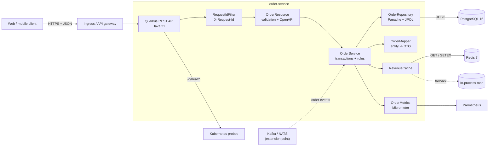

# Architecture

## Context

`order-service` is a single-currency order management API for a storefront. It
owns the order aggregate and exposes synchronous REST endpoints to a web or
mobile client. The service is intentionally small enough to run on a laptop but
structured like a production service: explicit transactions, a documented state
machine, idempotent writes, schema migrations, health probes, metrics, and
defence-in-depth deployment manifests.

## Component diagram

The Kafka/NATS box is deliberately dashed: the current implementation does not
require a broker. A production extension would publish an `OrderCreated` /
`OrderStatusChanged` event after the database transaction commits (transactional
outbox pattern), keeping the synchronous API independent of broker availability.

## Request flow

1. The ingress terminates TLS and forwards the request.
2. `RequestIdFilter` accepts a safe caller-supplied `X-Request-Id` or generates a
   UUID, stores it in a request-scoped bean, and returns it on the response.
3. `OrderResource` deserialises and validates the request with Jakarta Bean
   Validation.
4. `OrderService` opens a transaction, applies business rules, and delegates
   persistence to `OrderRepository`.
5. `OrderMapper` converts entities to immutable DTO records inside the
   transaction, so lazy collections are never serialised outside a session.
6. On failure, `ApiExceptionMappers` returns the standard `ErrorResponse`
   envelope with the same request id.
7. Micrometer records counters; Prometheus scrapes `/q/metrics`.

## Layering rules

| Layer | Package | Responsibility | Must not |
| --- | --- | --- | --- |
| HTTP adapter | `order.api` | Routing, validation, status codes, OpenAPI | Contain business rules or touch entities directly |
| Application service | `order` | Transactions, state machine, idempotency, aggregation | Serialise HTTP responses or know about JAX-RS |
| Domain | `order`, `pricing` | Aggregate invariants, status transitions, money math | Depend on Quarkus or a database |
| Persistence | `order.OrderRepository` | Panache queries and JPQL projections | Contain HTTP or presentation concerns |
| Infrastructure | `cache`, `config` | Redis with fallback, typed config, request context | Leak into domain logic |

## Transactions and consistency

- Each write is one database transaction (`@Transactional` on the service).
- The order and its line items are persisted through a cascading aggregate; the
  database foreign key and check constraints are the last line of defence.
- `@Version` on `Order` enables optimistic locking. Concurrent updates surface
  as HTTP 409 `CONCURRENT_MODIFICATION` instead of silently overwriting data.
- `Idempotency-Key` is stored in a unique column. A repeated key returns the
  original order with HTTP 200; a unique constraint prevents duplicate rows if
  two requests race.
- Cancellation is a status transition, not a delete, so financial history and
  audit trails survive.
- Revenue is computed from committed rows with a `GROUP BY` JPQL query. The
  cache is an optimisation, never the source of truth.

## Caching

`RevenueCache` uses Redis when `app.cache.redis-enabled=true` and falls back to a
TTL-bounded `ConcurrentHashMap` when Redis is disabled or unavailable. Reads and
writes catch connection failures and log at debug level, so a Redis outage
degrades latency rather than availability. The TTL defaults to 30 seconds and is
configurable with `APP_CACHE_TTL`.

## Failure modes

| Dependency | Failure | Behaviour |
| --- | --- | --- |
| PostgreSQL | Connection lost | Requests fail with 500; readiness fails; Kubernetes restarts or removes the pod from endpoints |
| Redis | Unavailable | Cache falls back to memory; API stays available |
| Redis | Slow | Bounded by client timeout; fallback after failure |
| Duplicate request | Same idempotency key | Existing order returned; no duplicate |
| Concurrent update | Version mismatch | 409 with a retry hint |
| Invalid transition | State machine violation | 409 with a descriptive code |
| Oversized/invalid payload | Validation failure | 400 with field-level violations |

## Scaling

The API is stateless apart from the local cache fallback. Scale horizontally
behind the Service; HPA targets CPU and memory. Database connection pools are
bounded per pod, so the aggregate pool size must be considered when increasing
replicas. The revenue cache is shared through Redis in production, avoiding a
cache stampede on every replica.

## Extension points

- **Kafka/NATS**: add a transactional outbox table and a relay, or publish after
  commit with an idempotent consumer. Do not publish inside the transaction.
- **Authentication**: add `quarkus-oidc`, validate JWT scopes, and map
  `customerId` to the token subject. The current demo intentionally has no auth
  so the API can be exercised locally without an identity provider.
- **Multi-currency**: the current deployment accepts one configured currency.
  Multi-currency would require grouping revenue by currency and a rates table.
- **Search**: replace the status filter with PostgreSQL full-text or an external
  index if order search grows beyond simple pagination.
