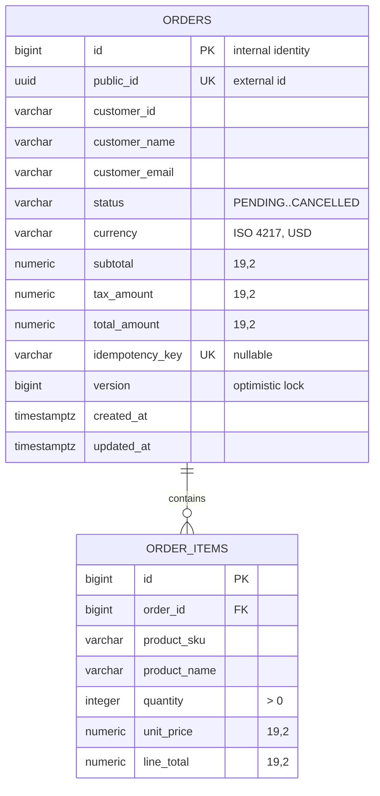
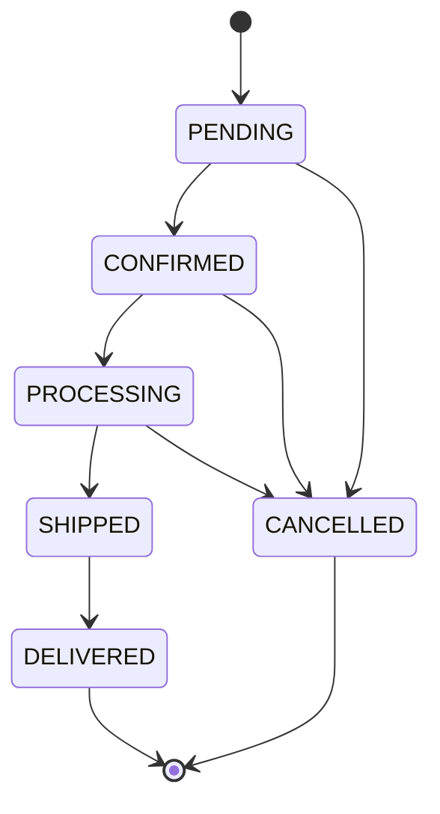

# Data model

## Entity-relationship diagram

## Tables

### `orders`

| Column | Type | Constraints | Notes |
| --- | --- | --- | --- |
| `id` | `BIGINT` | PK, identity | Internal only; never exposed |
| `public_id` | `UUID` | NOT NULL, unique | Public API identifier |
| `customer_id` | `VARCHAR(64)` | NOT NULL | Opaque customer reference |
| `customer_name` | `VARCHAR(200)` | NOT NULL | Display / invoice name |
| `customer_email` | `VARCHAR(320)` | NOT NULL | Contact email |
| `status` | `VARCHAR(32)` | NOT NULL, check | State machine value |
| `currency` | `VARCHAR(3)` | NOT NULL, check length | Single configured currency |
| `subtotal` | `NUMERIC(19,2)` | NOT NULL, >= 0 | Sum of line totals |
| `tax_amount` | `NUMERIC(19,2)` | NOT NULL, >= 0 | Rounded tax |
| `total_amount` | `NUMERIC(19,2)` | NOT NULL, >= 0, = subtotal + tax | Rounded total |
| `idempotency_key` | `VARCHAR(128)` | unique, nullable | Retry safety |
| `version` | `BIGINT` | NOT NULL, default 0 | Hibernate optimistic lock |
| `created_at` | `TIMESTAMPTZ` | NOT NULL | Set on persist |
| `updated_at` | `TIMESTAMPTZ` | NOT NULL | Set on persist/update |

### `order_items`

| Column | Type | Constraints | Notes |
| --- | --- | --- | --- |
| `id` | `BIGINT` | PK, identity | Internal |
| `order_id` | `BIGINT` | FK -> orders(id), ON DELETE CASCADE | Aggregate link |
| `product_sku` | `VARCHAR(64)` | NOT NULL | Normalised to uppercase |
| `product_name` | `VARCHAR(200)` | NOT NULL | Display name |
| `quantity` | `INTEGER` | NOT NULL, check > 0 | 1-1000 at the API |
| `unit_price` | `NUMERIC(19,2)` | NOT NULL, >= 0 | At least 0.01 at the API |
| `line_total` | `NUMERIC(19,2)` | NOT NULL, >= 0 | quantity * unit_price |

## Indexes

| Index | Purpose |
| --- | --- |
| `idx_orders_status_created_at` | Status-filtered list, newest first |
| `idx_orders_created_at` | Global newest-first pagination |
| `idx_orders_customer_id` | Future customer history queries |
| `idx_order_items_order_id` | Fetching an order's lines |

`public_id` and `idempotency_key` are unique indexes. PostgreSQL allows multiple
`NULL` values in a unique column, so orders without an idempotency key coexist.

## State machine

The transition table lives in `OrderStatus`. `SHIPPED` and `DELIVERED` cannot be
cancelled; cancellation is a soft state change, never a row delete.

## Money and rounding

- All monetary columns are `NUMERIC(19,2)` and Java `BigDecimal`.
- Each line total is `unitPrice * quantity`, rounded `HALF_UP` to 2 decimals.
- Subtotal is the sum of rounded line totals.
- Tax is `subtotal * taxRate`, rounded `HALF_UP` to 2 decimals.
- Total is `subtotal + tax`, scale 2.
- The default tax rate is `0.0825`; it is configuration, not a database value.
- The database check constraint `total_amount = subtotal + tax_amount` catches
  programming errors that bypass the calculator.

## Flyway and test schema

- Production and dev use Flyway `V1__init.sql` with
  `quarkus.flyway.migrate-at-start=true` and Hibernate `validate`.
- Tests use H2 in PostgreSQL compatibility mode with
  `quarkus.hibernate-orm.database.generation=drop-and-create` and Flyway
  disabled. This keeps the test suite Docker-free and fast.
- The migration is PostgreSQL-first but intentionally avoids vendor-specific
  features that H2 cannot parse, so it can also be applied to H2 when debugging.
- Migrations are forward-only. See [operations.md](operations.md) for rollback
  strategy.
